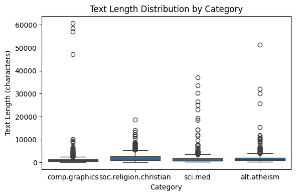
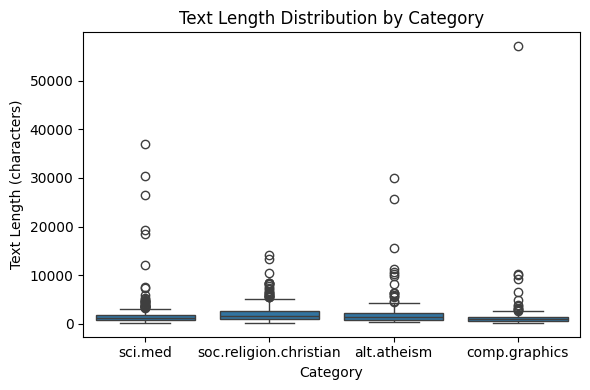
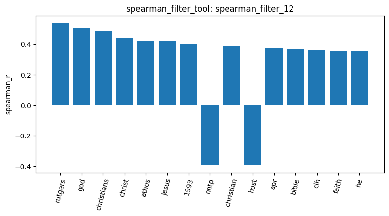
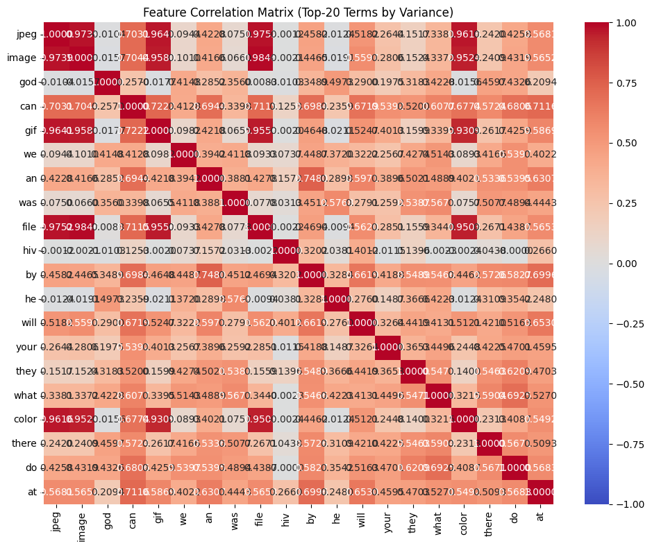
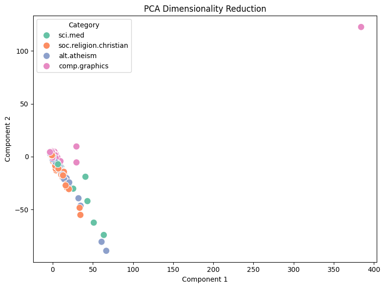
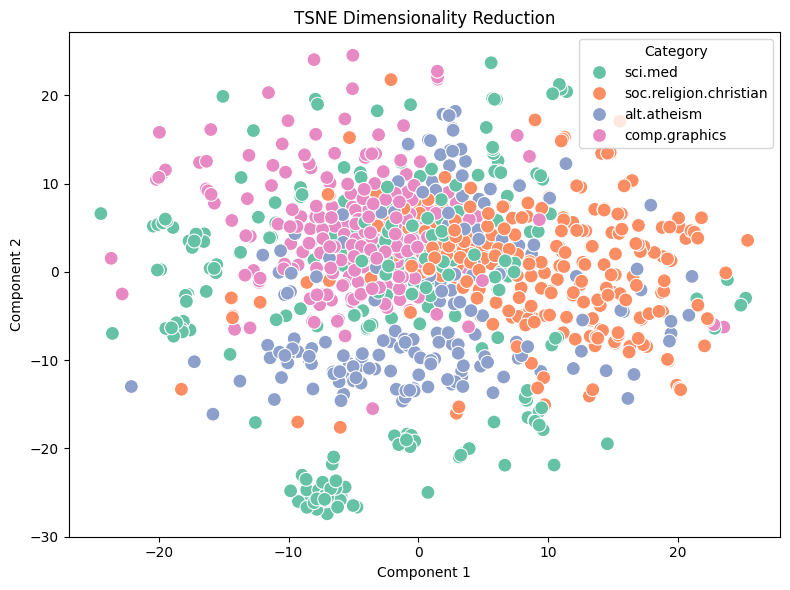
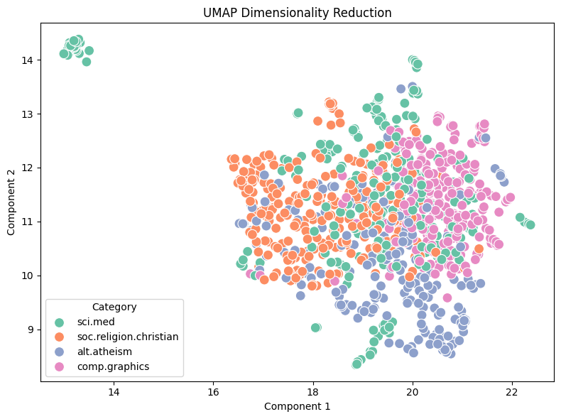

# Agentic Pipeline Report: 20-Newsgroups (4 categories)

## 1. Data loading and quality checks

I loaded 4 categories for the analysis: alt.atheism, soc.religion.christian, comp.graphics, and sci.med, with 480, 599, 584, and 594 documents respectively (2,257 in total, `load_dataset_1`). I chose these 4 categories because they are the same ones used in the Master notebook, so I could compare my results against it and confirm that my custom tools work correctly.

When I inspected the data (`inspect_data_2`), I found a lot of noise besides the actual content, such as `From:` and `Subject:` header lines and email addresses. Luckily, there were no missing values or duplicated documents (`check_missing_3`, `check_duplicates_4`).

I then used the describe data tool to look at the text-length distribution (`describe_data_5`). comp.graphics has the lowest median length (883 characters) but the largest maximum (60,713), while soc.religion.christian has the highest median (1,649) and the smallest standard deviation. This shows the data contains a few very long documents that are far beyond the length of most documents.

Next, I sampled 1,000 documents (`sample_data_6`). The category proportions and length statistics stayed close to the original data (`describe_data_7`), so the sample is representative.

## 2. Document-term matrix and term filtering

I built the DTM with `min_df=2` and `max_df=0.5` (`build_dtm_8`), to remove words that appear in only one document and words that appear in more than half of the documents. The resulting matrix has 11,069 terms and is very sparse (sparsity = 98.84%). The DTM heatmap (`dtm_heatmap_10`) also shows that the matrix is almost entirely zeros, which confirms how sparse the data is: most documents use only a small fraction of the vocabulary.

In `term_frequency_9`, the top words are still stop words such as can (1,319) and was (1,301). `max_df` removed the most common stop words like the and of, but it could not remove these. god (1,018) is the first informative word in the list.

I applied the variance filter with a threshold of 0.01 (`variance_filter_11`), which removed 6,649 terms and kept 4,420.

Then I applied the Spearman filter on soc.religion.christian with a threshold of 0.1 (`spearman_filter_12`). I chose Spearman because it is less sensitive to outliers than Pearson, which matters here since some documents are extremely long. 362 terms were kept. The results look reasonable: positively correlated words include god, christians, christ, jesus, bible, faith, and church, and negatively correlated words include nntp, posting, host, graphics, medical, and computer. Some highly correlated words, such as rutgers, athos, clh, geneva, 1993, and apr, are not related to the topic of the category; they are probably dates or parts of email addresses from the post headers.

In the feature correlation heatmap (`feature_correlation_13`), file, image, jpeg, gif, and color form a strongly correlated group, while god and jpeg are almost uncorrelated. This suggests that strongly correlated words tend to come from the same category, while uncorrelated words come from different categories.

## 3. Frequent pattern mining

I mined patterns with the `topk` algorithm, `k=10`, and `tfidf` filtering. I chose Top-K because it does not require guessing a minimum support value, which would otherwise be hard to set. I found that the top-10 patterns for comp.graphics and soc.religion.christian are almost identical: all of them are made of lines, subject, organization, and edu (`mine_patterns_14`, `mine_patterns_15`). I think the reason is that these are email header words that appear in every post, so their support is almost equal to the number of documents in each category (247 for comp.graphics and 270 for soc.religion.christian). Although the tool removes English stop words, these header words are not on the stop-word list.

I then tried `variance` filtering instead (`mine_patterns_16`). lines and edu disappeared, but subject and organization remained, and another header word, keywords, appeared. Finally, I compared this with the Master notebook, which shows the same phenomenon; it deals with it by mining many more patterns and removing patterns shared across categories.

## 4. Dimensionality reduction

I ran three dimensionality reduction methods: PCA, t-SNE, and UMAP (`reduce_dimensions_17`, `18`, `19`). The first two PCA components explain only 37.01% of the variance (26.34% + 10.67%), so a 2D PCA plot may not represent the data very well. UMAP gives the clearest separation: soc.religion.christian and comp.graphics are separated best, while sci.med is the most scattered. In addition, alt.atheism overlaps more with soc.religion.christian, because the two categories use very similar words.

## 5. Label binarization and document similarity

Finally, I binarized the labels into one-hot encoding (`binarize_labels_20`), which also showed me the categories of documents 0, 1, and 2 (sci.med, soc.religion.christian, and sci.med). I then used cosine similarity to compare documents from the same and from different categories. Documents 0 and 2 (both sci.med) have a similarity of 0.0924 (`cosine_similarity_21`), while documents 0 and 1 (different categories) have 0.0393 (`cosine_similarity_22`). Documents in the same category are more similar, but both values are still quite small because the data is very sparse.

## 6. Conclusion

After analyzing the whole pipeline, I think header noise is the biggest problem. I could already see meaningless header information when inspecting the data, and it still affected the results later, in the Spearman filter (words like rutgers) and in pattern mining (lines and subject dominating the top-10). Each filtering step I used has its limits: `max_df` cannot remove mid-frequency stop words, the variance filter also throws away rare but meaningful words, and only the Spearman filter really removed the stop words and kept topic words. Despite the noise, topic words such as god, jesus, jpeg, and image still separate the categories in the correlation analysis and in UMAP.

If I did this again, I would remove the headers when loading the data.
