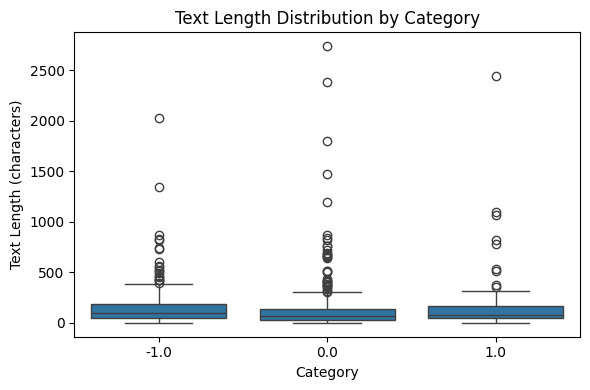
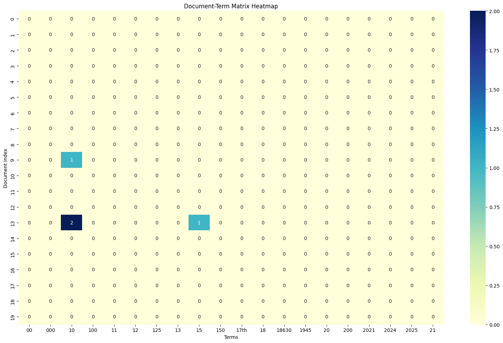
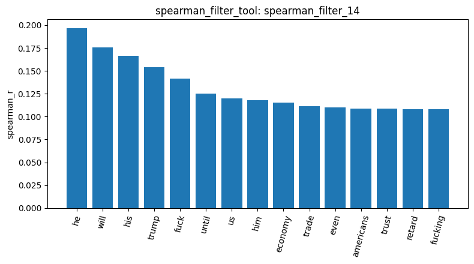
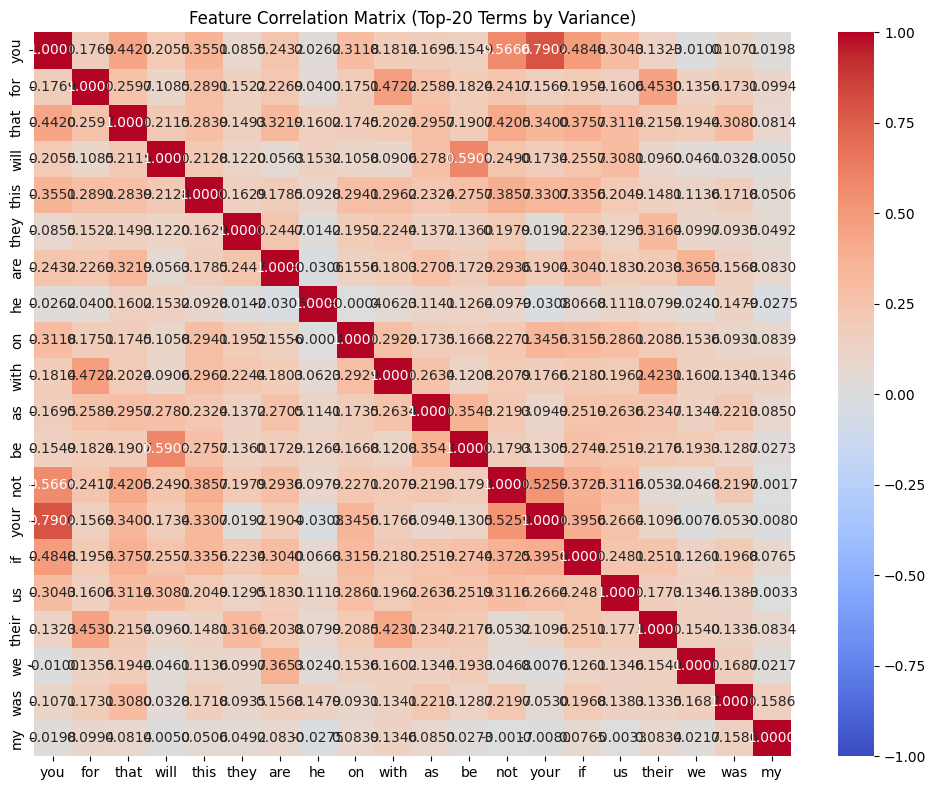
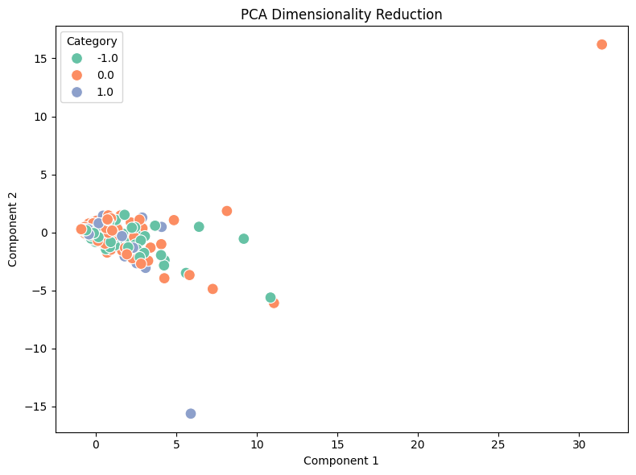
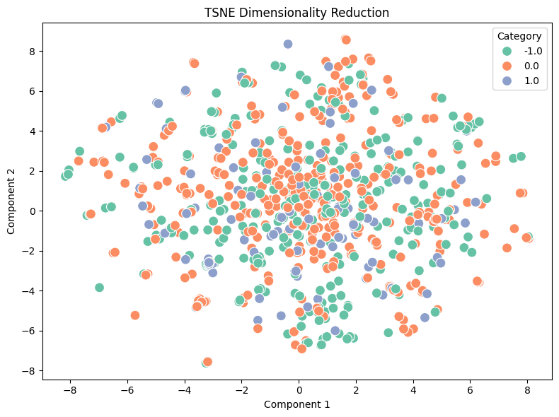
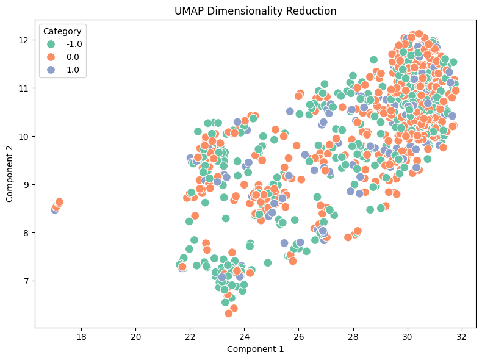

# Homework Report: Reddit Stock Sentiment

## 1. Data loading and quality checks

I loaded `newdataset/Reddit-stock-sentiment.csv` with `text` as the text column and `label` as the label column (`load_dataset_1`). It has 847 documents in three sentiment classes: 423 neutral (`0.0`), 315 negative (`-1.0`) and 109 positive (`1.0`). The classes are imbalanced: the positive class makes up only about 13% of the data.

Inspecting the first rows (`inspect_data_2`) showed that, unlike the 20-newsgroups data, this dataset has no header noise such as `Subject:` lines or email addresses. Most documents are short Reddit comments with slang and insults (for example "Calls on retards") and stock tickers, plus a few long posts, such as a 1,067-character promotional post. There were no missing texts (`check_missing_3`). There were 23 duplicate documents (`check_duplicates_4`, about 2.7% of the data). Duplicates could bias the later term counts and patterns, and they are only a small part of the data, so I dropped them with `drop=True` (`check_duplicates_5`). This removes every copy of a duplicated text, so 813 documents remained instead of 824.

## 2. Text length

`describe_data_6` shows the texts are short and right-skewed: the median is 78 characters, the mean is 147.2 and the maximum is 2,737. The mean is almost twice the median because a few very long posts pull it up. By class, the medians are 96 (negative), 68 (neutral) and 77 (positive), so negative comments tend to be slightly longer. Overall the documents are much shorter than in 20-newsgroups, where the median length per category was roughly 880 to 1,650 characters. Short texts mean each document contains only a few words, which affects every later step.

I did not subsample this time. There are only 813 documents and only 107 positive ones, and sampling would shrink the positive class even further, leaving it even more dominated by the majority classes.

## 3. Document-term matrix

I built the DTM with `min_df=2` and `max_df=0.2` (`build_dtm_7`), which gave 1,652 terms and a sparsity of 99.086%. I lowered `max_df` from the 0.5 I used for 20-newsgroups to 0.2, because with such short texts no term appears in 50% of the documents, so 0.5 would not remove anything.

The top terms by frequency (`term_frequency_8`) were all stop words: that (220), for (209), this (209), you (195), on (167). This is expected, because `build_dtm_tool` has no stop-word filter by design; only `mine_patterns_tool` removes stop words.

The heatmap slice (`dtm_heatmap_9`) is almost empty. Only 2 non-zero cells appear in the first 20 documents × 20 terms, and those terms are numbers like `00`, `10` and `100`. The matrix is very sparse, as it was for 20-newsgroups, and even more so here because each document is short.

## 4. Feature filtering

**Variance.** I tried three thresholds: 0.005 (`variance_filter_10`, 730 kept / 922 removed), 0.002 (`variance_filter_11`, all 1,652 kept) and 0.004 (`variance_filter_12`, 852 kept / 800 removed). I settled on 0.005 (`variance_filter_13`). The 0.002 threshold removes nothing because, after `min_df=2`, the lowest possible variance (a term that appears once in each of 2 documents) is about 0.0025. The 0.004 threshold only added back more rare terms, and the kept list was still led by the same stop words, so it was not more informative and I went back to 0.005. The cost is that it removes some tickers and names, such as nvda, tsla and crypto, which appear in only 2 or 3 documents. With so few occurrences, those terms would not give a reliable signal in the correlation step anyway. This threshold is lower than the 0.01 I used in the pipeline run, because this dataset has far fewer documents and much shorter texts, so most terms have low variance.

**Spearman.** I correlated each term with the negative class (`spearman_filter_14`, target `-1.0`, threshold 0.1), and 18 terms passed. The strongest were he (0.1965), will (0.1758), his (0.1664), trump (0.1539) and fuck (0.1418), and further down economy (0.1151), trade (0.1111) and china (0.1053). I chose Spearman because it is less sensitive to outliers, such as the few very long posts. I chose the negative class because it has about three times as many documents as the positive class and its language is more emotional, so it should give a clearer signal. The results look reasonable: negative posts talk about Trump ("he", "his", "him", "trump"), the trade war with China ("trade", "economy", "china", "americans") and contain a lot of swearing ("fuck", "fucking", "retard"). However, all correlations are weak (the maximum is about 0.2), so no single word is a strong indicator of negative sentiment.

**Feature correlation.** `feature_correlation_15` picked the top 20 terms by variance from the full DTM, and all 20 were stop words. The strongest pairs were you/your (0.7902) and will/be (0.5906). These correlations reflect English grammar (words that usually appear together in a sentence), not the actual content of the posts.

## 5. Frequent patterns

I mined the top 15 patterns per class with TopK (FAE) and TF-IDF filtering:

| Class | result_id | Top patterns (support) |
| --- | --- | --- |
| Negative `-1.0` | `mine_patterns_16` | trump 45, just 42, china 33, like 25, market 23, money 19, economy 17, tariffs 16 |
| Neutral `0.0` | `mine_patterns_17` | like 36, just 31, market 28, trump 23, china 22, want 20, stock 14, company 13 |
| Positive `1.0` | `mine_patterns_18` | just 15, good 12, doing 9, like 8, economy 6, technology 5, silver 5, tariffs 5 |

In the negative class, trump, china and tariffs are at the top, which matches the Spearman result. The neutral class is more about the market itself (market, stock, company), and the positive class has words like good, technology and new. All top-15 patterns are single words, because on short texts word pairs rarely appear together often enough to reach a high support. I chose TopK instead of FP-Growth because it is easier to tune: a poorly chosen minimum support could return no patterns at all on such a small dataset, or far too many.

## 6. Dimension reduction

PCA (`reduce_dimensions_19`): PC1 explains 11.60% and PC2 4.50% of the variance, 16.10% in total. The plot does not separate the three classes at all. Only 16% of the variance is captured, and the components are driven by high-variance stop words rather than sentiment words.

I also ran t-SNE (`reduce_dimensions_20`) and UMAP (`reduce_dimensions_21`), both with the default settings (perplexity 30 for t-SNE, 15 neighbors for UMAP, random_state 42). The three classes are still mixed together, although the points are spread more widely than in PCA. This is probably because the dataset is small and each document has very few words, so the word-count vectors carry little information about sentiment.

## 7. Label binarization and cosine similarity

Binarizing the labels (`binarize_labels_22`) produced an 813 × 3 matrix with classes `-1.0`, `0.0` and `1.0`. Each row has a single 1. For example, document 0 is `[1, 0, 0]` (negative) and documents 1 and 2 are `[0, 1, 0]` (neutral). There is one column per class, so the three sentiment classes give three columns.

I then compared two neutral documents, 1 and 2 (`cosine_similarity_23`), and a negative and a neutral document, 0 and 1 (`cosine_similarity_24`). Both similarities were 0.0, because the documents share no terms in the DTM vocabulary. For example, document 0 is only "Calls on retards" (16 characters) and document 2 is "Seeing lots of red in the ticker." (33 characters). With a median length of 78 characters, most pairs of documents have no words in common, so cosine similarity on raw counts cannot tell same-sentiment pairs from different-sentiment pairs.

## 8. Conclusion

My tools ran on this dataset without any changes, even though it has three classes instead of the two- or four-category setups I used before, so I think they generalize well. The analysis was much harder than with 20-newsgroups, however. The texts are short and the dataset is small, so stop words dominate the frequency, variance and feature-correlation results, the correlations with sentiment are weak (at most about 0.2), and the classes overlap completely in all three dimension-reduction plots. The clearest finding is that negative posts are associated with Trump, China and the trade war, and with swearing. The positive class is small (107 documents), which makes it especially hard to analyze. If I did this again, I would add stop-word removal to `build_dtm_tool` and try TF-IDF weighting, so that the filtering, correlation and dimension-reduction steps would focus on content words rather than function words.
